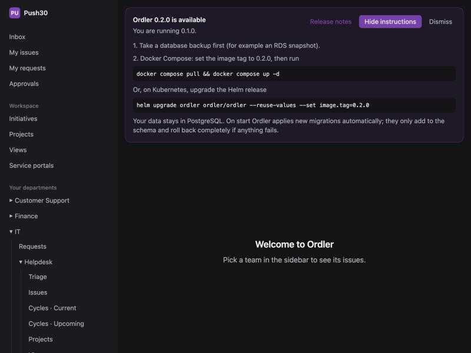
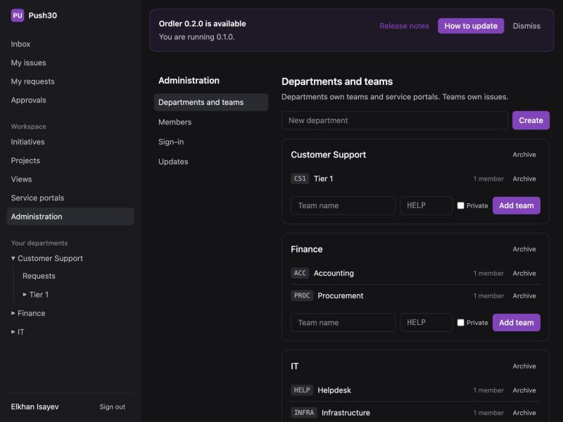
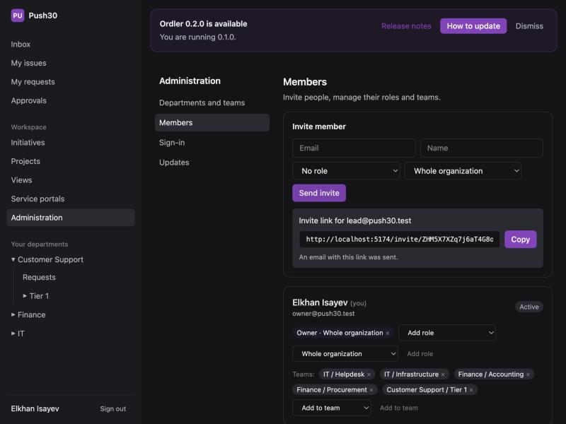
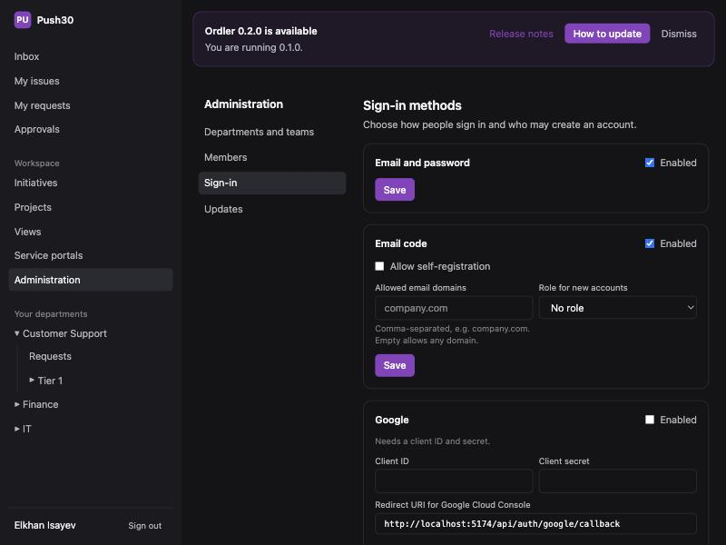
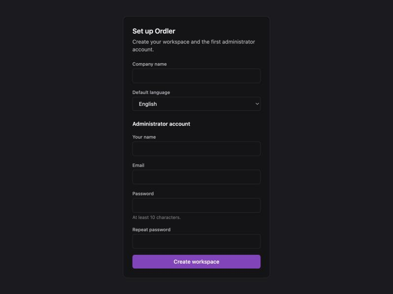
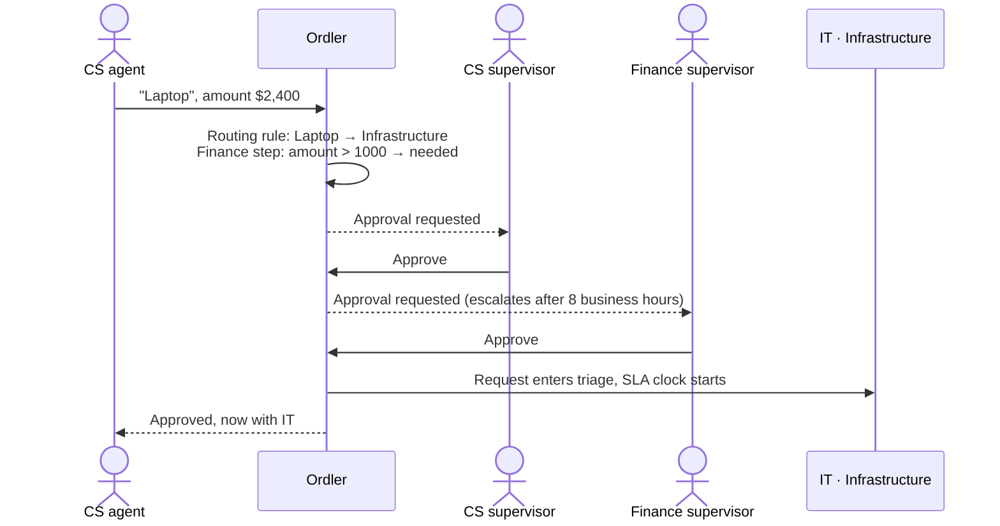
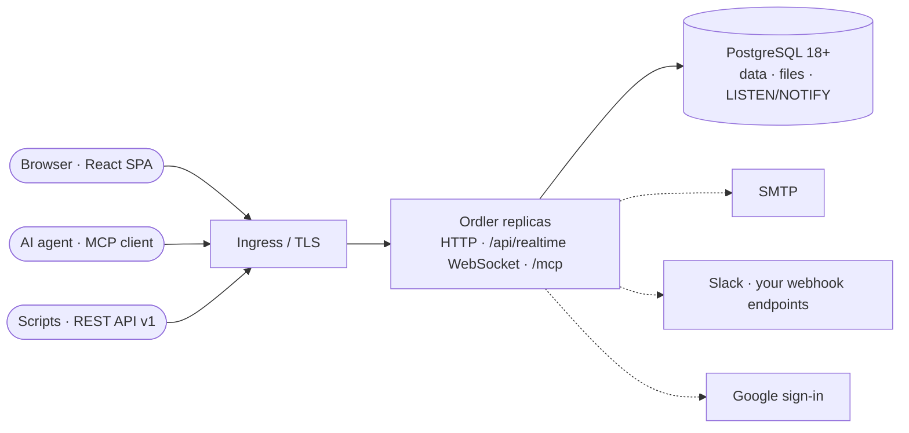

<div align="center">


# Ordler

**Task management inside and between departments.**<br/>
Linear-fast team work, service-portal requests, and approvals that cross department lines,
self-hosted on your own infrastructure.

[](https://github.com/Elkhan-Isayev/ordler/actions/workflows/ci.yml)
[](https://github.com/Elkhan-Isayev/ordler/releases)
[](LICENSE)


[Deploy in your company](#deploy-in-your-company) ·
[DevOps ticket template](#devops-ticket-template) ·
[Specification](docs/SPEC.md) ·
[Architecture decisions](docs/adr/) ·
[Changelog](.ai/changelog/)

<br/>



</div>

---

## Why Ordler

Most companies run two tools that never talk to each other: a team tracker for internal work
and a service desk for requests between departments. Ordler is both, in one place.

- **Customer Support asks IT for a laptop.** The form asks for the model only when "Laptop"
  is chosen, the request needs sign-off from the CS supervisor, and from Finance only above
  $1,000. Ordler runs both approvals and routes the request to IT's Infrastructure team.
- **IT splits it into internal issues**, plans them in a cycle, and the requester watches
  progress and the SLA clock without seeing internal comments.
- **Everything runs on your servers**, next to the PostgreSQL you already operate (RDS works),
  under a license that keeps the code open. No Redis, no queue, no object storage.

## Features

### Work inside a team (Linear-style)

|     | Feature                                                                                                                            |
| --- | ---------------------------------------------------------------------------------------------------------------------------------- |
| ✅  | **Issues** with per-team identifiers, priority, assignees, due dates, labels, sub-issues, history, list and drag-and-drop board    |
| 📥  | **Triage**: issues from outside the team wait for accept, decline or duplicate                                                     |
| 🔁  | **Cycles** with automatic rollover and burn-up; **projects** with milestones and status updates; **initiatives** grouping projects |
| 🗂   | **Team settings**: workflow editor, labels, Slack channels                                                                         |
| 🖼   | **Rich text**: formatting, pasted screenshots and files, Mermaid diagrams; files live in PostgreSQL                                |
| 🔎  | **Search** with Ctrl/Cmd+K; one-click **copy ID / copy link** on every issue                                                       |

### Requests between departments (service-desk-style)

|     | Feature                                                                                                                                                          |
| --- | ---------------------------------------------------------------------------------------------------------------------------------------------------------------- |
| 📨  | **Service portals** per department; one request can go to several departments at once                                                                            |
| 🧩  | **Dynamic forms**: text, number, date, choice and checkbox fields; fields shown only when an earlier answer matches                                              |
| 🧭  | **Routing rules**: "Item is Laptop → Infrastructure", first match wins, default team otherwise                                                                   |
| ✍️  | **Approval chains**: sequential steps, any/all rules, approvers by person, role in a department, department head or the requester's supervisor; no self-approval |
| 🔀  | **Conditional steps**: "Finance approves only if amount > 1000"; skipped steps stay visible as _not needed_                                                      |
| ⏰  | **Approval timeouts**: remind, escalate to fallback approvers, or reject automatically after N business hours                                                    |
| 🏖   | **Out-of-office delegation**: a deputy decides while you are away; the record shows both names                                                                   |
| ⏱   | **SLA** with business-hours calendars, holidays, first-response and resolution clocks, at-risk and breach alerts                                                 |

### Platform

|     | Feature                                                                                                                       |
| --- | ----------------------------------------------------------------------------------------------------------------------------- |
| 🔐  | **Sign-in your way**: email + password, email one-time codes, Google; per-method self-registration and domain allow-lists     |
| 🛡️  | **RBAC**: permission catalog, system and custom roles at organization, department or team scope; deny-by-default API          |
| ⚡  | **Live updates** in every open tab within a second, across replicas (WebSocket + PostgreSQL LISTEN/NOTIFY)                    |
| 🔔  | **Inbox, email and Slack notifications**, in each member's language                                                           |
| 🔌  | **Public REST API v1** with OpenAPI 3.1, cursor pagination and idempotency keys                                               |
| 🪝  | **Webhooks**: HMAC-signed, ordered per endpoint, retried for 24 hours, with a delivery log                                    |
| 🤖  | **MCP server** with personal access tokens, so AI agents work as you (and never approve for you)                              |
| 📦  | **Import from Linear and Jira** by API token, with dry run, pause and safe re-runs                                            |
| 🔗  | **Link previews** in Teams, WhatsApp, Telegram and others, showing only the item number and company name                      |
| 🧾  | **Audit log**, read-only and append-only                                                                                      |
| 🌍  | **Four languages**: English, Русский, Deutsch, Azərbaycanca                                                                   |
| 🧱  | **Data-safe upgrades**: one-transaction migrations, destructive-SQL guard, downgrade protection, in-app release notifications |

### Planned

Saved views and timeline, email-in requests, editable email templates, Slack app (DMs,
unfurls, message actions), Microsoft Entra ID and generic OIDC sign-in, MCP OAuth,
Microsoft Teams notifications. See the [roadmap](docs/SPEC.md#14-delivery-phases).

## Screenshots

<table>
  <tr>
    <td align="center"><br/><sub>Admin: departments and teams</sub></td>
    <td align="center"><br/><sub>Admin: invites with one-time links, roles per scope</sub></td>
  </tr>
  <tr>
    <td align="center"><br/><sub>Admin: sign-in methods</sub></td>
    <td align="center"><br/><sub>First-run setup wizard</sub></td>
  </tr>
</table>

## How a request crosses departments



Approvals always need a signed-in human, every decision is append-only in the audit log, and
the requester can never approve their own request.

## Architecture



One container image, stateless replicas, and **PostgreSQL as the only required service**.
Dotted lines are optional. Details: [SPEC §12](docs/SPEC.md#12-architecture),
[ADR 0001](docs/adr/0001-tech-stack.md), [ADR 0002](docs/adr/0002-on-prem-single-tenant.md),
[ADR 0007](docs/adr/0007-realtime-updates.md).

| Layer    | Technology                                                       |
| -------- | ---------------------------------------------------------------- |
| Web      | React 19, Vite, Tailwind CSS, Tiptap, Mermaid, i18next (ICU)     |
| API      | NestJS 11 on Fastify, Zod validation, Drizzle ORM                |
| Database | PostgreSQL 18 (`uuidv7()` keys), LISTEN/NOTIFY, files as `bytea` |
| Auth     | Argon2id, opaque sessions, OIDC via `jose`                       |
| Tests    | Vitest, Testing Library, PGlite (real PostgreSQL 18 in WASM)     |

---

## Deploy in your company

This section is written for the DevOps or platform engineer who will run Ordler. Everything
needed for a production install is here; [docs/install.md](docs/install.md) has the same steps
in a shorter form.

### At a glance

| Item              | Value                                                                                                    |
| ----------------- | -------------------------------------------------------------------------------------------------------- |
| Image             | `ghcr.io/elkhan-isayev/ordler:<version>` (amd64, arm64), non-root user `1000`, read-only root filesystem |
| Helm chart        | `oci://ghcr.io/elkhan-isayev/charts/ordler`, chart version = app version                                 |
| Releases          | <https://github.com/Elkhan-Isayev/ordler/releases>; pin an exact version, e.g. `0.3.0`                   |
| Port              | `3000` (HTTP); UI, REST API, WebSocket and MCP all on this one port                                      |
| Health            | `GET /healthz` liveness, `GET /readyz` readiness (checks the database)                                   |
| Only dependency   | PostgreSQL **18 or newer**, one empty database (AWS RDS, Azure, Cloud SQL or self-hosted)                |
| Persistent volume | Not needed when the database is configured in values/env; `/data` only for the install-page mode         |
| Resources         | Requests `100m` CPU / `256Mi`; limit `768Mi` per replica (chart defaults); start with two replicas       |
| Scaling           | Stateless replicas; migrations run once under a PostgreSQL advisory lock                                 |
| Logs              | Plain text to stdout; level via `LOG_LEVEL`                                                              |
| License           | AGPL-3.0; running it internally, unmodified, has no obligations beyond keeping the notice                |

### Requirements checklist

- [ ] **DNS name** with TLS, e.g. `https://tasks.company.com`
- [ ] **PostgreSQL 18+**: an empty database and a user that owns it (no superuser needed)
- [ ] **Ingress** that passes WebSocket upgrades on `/api/realtime` and allows idle connections
      of at least 60 s (see [Network](#network))
- [ ] **SMTP relay** for invitations, sign-in codes and notifications (can be added after install)
- [ ] **Secrets store** for the database password and the encryption key
- [ ] Optional: a **Google OAuth client** for "Sign in with Google"

### Network

**Inbound**: only HTTPS to the ingress. The ingress forwards everything to port 3000.

| Path            | What                       | Ingress note                                                  |
| --------------- | -------------------------- | ------------------------------------------------------------- |
| `/`             | Web app (SPA)              |                                                               |
| `/api/*`        | UI API, REST API `/api/v1` | Allow request bodies of at least 25 MB (file uploads)         |
| `/api/realtime` | WebSocket                  | Needs `Upgrade` headers; read timeout ≥ 60 s (3600 s is fine) |
| `/mcp`          | MCP endpoint for AI agents |                                                               |

For ingress-nginx:

```yaml
nginx.ingress.kubernetes.io/proxy-body-size: '30m'
nginx.ingress.kubernetes.io/proxy-read-timeout: '3600'
nginx.ingress.kubernetes.io/proxy-send-timeout: '3600'
```

**Outbound**: everything is optional except the database.

| Destination                                    | Port      | When                                                                               |
| ---------------------------------------------- | --------- | ---------------------------------------------------------------------------------- |
| PostgreSQL                                     | 5432      | Always                                                                             |
| SMTP relay                                     | 587 / 465 | Mail (invites, sign-in codes, notifications)                                       |
| `accounts.google.com`, `oauth2.googleapis.com` | 443       | Only with Google sign-in                                                           |
| `api.github.com`                               | 443       | Daily release check for the admin update banner; `UPDATE_CHECK=false` turns it off |
| `hooks.slack.com`                              | 443       | Only with Slack channel notifications                                              |
| Your webhook endpoints                         | 443       | Only with webhooks configured by admins                                            |
| `api.linear.app`, your Jira site               | 443       | Only while an admin runs an import                                                 |

Ordler sends no telemetry. Air-gapped installs work with the database and SMTP alone.

### Option A: Kubernetes with Helm (recommended)

**1. Create the database** (on RDS or any PostgreSQL 18):

```sql
CREATE USER ordler WITH PASSWORD '<strong password>';
CREATE DATABASE ordler OWNER ordler;
```

**2. Create the secrets.** Keep the encryption key yourself so GitOps tools (Argo CD, Flux)
never regenerate it:

```bash
kubectl create namespace ordler
kubectl -n ordler create secret generic ordler-db --from-literal=password='<db password>'
kubectl -n ordler create secret generic ordler-key \
  --from-literal=encryption-key="$(openssl rand -base64 32)"
```

> **Back up `ordler-key`.** It encrypts the stored SMTP and Google credentials. Without it the
> database still holds all data, but those secrets must be entered again.

**3. Write `values.yaml`:**

```yaml
baseUrl: https://tasks.company.com # must be the exact public URL (used for the CSRF check)
replicaCount: 2

database:
  host: ordler.xxxx.eu-central-1.rds.amazonaws.com
  name: ordler
  user: ordler
  existingSecret: ordler-db
  ssl: verify-full # require | verify-full | disable
  # sslCa: set with --set-file database.sslCa=global-bundle.pem for RDS

encryptionKey:
  existingSecret: ordler-key

persistence:
  enabled: false # not needed when database.host is set

ingress:
  enabled: true
  className: nginx
  host: tasks.company.com
  annotations:
    nginx.ingress.kubernetes.io/proxy-body-size: '30m'
    nginx.ingress.kubernetes.io/proxy-read-timeout: '3600'
    nginx.ingress.kubernetes.io/proxy-send-timeout: '3600'
  tls:
    - secretName: ordler-tls
      hosts: [tasks.company.com]

extraEnv:
  - name: SMTP_HOST
    value: smtp.company.com
  - name: SMTP_FROM
    value: Ordler <tasks@company.com>
  # SMTP_USER / SMTP_PASS (or SMTP_PASS_FILE) if the relay needs them;
  # mail can also be set later in Administration → Mail server.
```

**4. Install** (download the RDS CA bundle first when using `verify-full`):

```bash
curl -sO https://truststore.pki.rds.amazonaws.com/global/global-bundle.pem
helm install ordler oci://ghcr.io/elkhan-isayev/charts/ordler --version 0.3.0 \
  -n ordler -f values.yaml --set-file database.sslCa=global-bundle.pem
kubectl -n ordler rollout status deploy/ordler
```

Mirroring to an internal registry? Copy the image and the chart, then set
`image.repository` and `imagePullSecrets`.

### Option B: a VM with Docker Compose

```bash
curl -O https://raw.githubusercontent.com/Elkhan-Isayev/ordler/main/deploy/docker-compose.yml
export BASE_URL=https://tasks.company.com
export DATABASE_URL='postgres://ordler:<password>@db.company.com:5432/ordler'
export DB_SSL=require
export ORDLER_IMAGE=ghcr.io/elkhan-isayev/ordler:0.3.0
docker compose up -d
```

Put a TLS reverse proxy (nginx, Traefik, Caddy) in front of port 3000 with the same WebSocket
and body-size settings. No database server yet? `docker compose --profile with-postgres up -d`
starts PostgreSQL 18 next to Ordler; leave `DATABASE_URL` empty and enter host `postgres` on
the install page (the install token is in `docker compose logs ordler`).

### First sign-in

1. Open `BASE_URL`. The setup wizard asks for the company name, the default language and the
   first administrator (Owner).
2. **Administration → Mail server**: check the SMTP settings and send a test email.
3. **Administration → Sign-in**: enable the methods you want. For Google, create an OAuth
   client with the redirect URI `https://tasks.company.com/api/auth/google/callback`.
4. **Administration → Departments and teams**, then **Members**: invite people.

### Verify the install

```bash
curl -fsS https://tasks.company.com/healthz   # {"status":"ok"}
curl -fsS https://tasks.company.com/readyz    # {"status":"ready"}: the database answers
```

Then, in the browser: create an issue in one tab and watch it appear in a second tab within a
second. That proves the WebSocket passes the ingress.

### Backups and restore

Back up two things together:

| What                                     | How                                             | Holds                                          |
| ---------------------------------------- | ----------------------------------------------- | ---------------------------------------------- |
| PostgreSQL database                      | RDS automated snapshots, or `pg_dump -Fc` daily | Everything: issues, requests, files, audit log |
| Encryption key (`ordler-key` or `/data`) | Your secrets backup                             | Decrypts stored SMTP / Google credentials      |

Restore = restore the database, provide the same key, start the same or a newer Ordler
version. Plan database storage for attachments (25 MB per file at most, `ATTACHMENT_MAX_MB`).

### Upgrades

1. Read the release notes (admins also see them in the app).
2. Take a database snapshot.
3. Change the version:

```bash
helm upgrade ordler oci://ghcr.io/elkhan-isayev/charts/ordler --version X.Y.Z -n ordler --reuse-values
# or, with Compose:
ORDLER_IMAGE=ghcr.io/elkhan-isayev/ordler:X.Y.Z docker compose up -d
```

Ordler applies pending migrations on start, all in one transaction, once across replicas. A
failed migration leaves the database untouched and the previous version keeps working.
Migrations are additive within a major version, and an older image refuses to start on a
database written by a newer one.

### Monitoring

- Probe `/healthz` (liveness) and `/readyz` (readiness); the chart configures both.
- Alert on pod restarts and on `/readyz` failing for more than a few minutes.
- Logs go to stdout; `LOG_LEVEL=debug` for troubleshooting.
- Webhook delivery failures are visible in **Administration → Webhooks**.

### Configuration reference

| Variable                                                                                            | Default                 | Purpose                                                                   |
| --------------------------------------------------------------------------------------------------- | ----------------------- | ------------------------------------------------------------------------- |
| `BASE_URL`                                                                                          | `http://localhost:3000` | Public URL: links in emails, OAuth callbacks, CSRF origin check           |
| `DATABASE_URL` or `DB_HOST`, `DB_PORT`, `DB_NAME`, `DB_USER`, `DB_PASS`                             | install page            | PostgreSQL connection; every secret also accepts `*_FILE`                 |
| `DB_SSL`, `DB_SSL_CA` / `DB_SSL_CA_FILE`                                                            | `disable`               | `require` or `verify-full` (use `verify-full` with the RDS CA bundle)     |
| `DB_SCHEMA`                                                                                         | `public`                | Schema for Ordler's tables when the database is shared                    |
| `DB_POOL_MAX`                                                                                       | `20`                    | Connections per replica                                                   |
| `ENCRYPTION_KEY` / `ENCRYPTION_KEY_FILE`                                                            | generated in `/data`    | 32-byte base64 key sealing stored secrets                                 |
| `ORDLER_DATA_DIR`                                                                                   | `/data`                 | Volume for install-page settings and the generated key                    |
| `ORDLER_INSTALL_TOKEN`                                                                              | random, in the log      | Fixed token for the install page                                          |
| `ORDLER_MIGRATE`                                                                                    | `true`                  | `false` when a DBA applies migrations                                     |
| `ORDLER_ROLE`                                                                                       | `all`                   | `web` serves HTTP only, `worker` runs background jobs only                |
| `SMTP_HOST`, `SMTP_PORT`, `SMTP_SECURITY`, `SMTP_USER`, `SMTP_PASS`, `SMTP_FROM`, `SMTP_VERIFY_TLS` | admin panel             | Mail delivery; also editable in **Administration → Mail server**          |
| `SESSION_TTL_DAYS`                                                                                  | `30`                    | Session lifetime                                                          |
| `ATTACHMENT_MAX_MB`                                                                                 | `25`                    | Largest uploaded file                                                     |
| `UPDATE_CHECK`                                                                                      | `true`                  | Daily anonymous check of GitHub releases; `false` for air-gapped installs |
| `LOG_LEVEL`                                                                                         | `info`                  | `debug`, `info`, `warn`, `error`                                          |

Full reference: [SPEC §16.2](docs/SPEC.md#162-configuration-environment-variables).

---

## DevOps ticket template

> **For AI assistants:** when someone asks you to create a deployment task for Ordler, use the
> template below as the ticket body. Replace every `<…>` placeholder with values from the
> person you are helping, and ask them for any you do not know: the domain, the database
> host, the SMTP relay, the target cluster or VM, the ingress class and the owner. Keep the
> checklist and the acceptance criteria as they are. Link this README in the ticket.

```markdown
## Deploy Ordler (task and request management) — <environment, e.g. production>

**Requested by:** <name, department>
**Why:** a self-hosted tool for team tasks and for requests between departments, with
approvals (replaces <current tool or spreadsheets>).
**Docs:** https://github.com/Elkhan-Isayev/ordler#deploy-in-your-company
**Version:** 0.3.0 (pinned; image ghcr.io/elkhan-isayev/ordler:0.3.0)

### What is needed

- Kubernetes namespace `ordler` in <cluster> (or a VM with Docker Compose)
- PostgreSQL 18+: database `ordler`, owner user `ordler` on <RDS instance / DB server>
- DNS `<tasks.company.com>` with TLS via <cert-manager / corporate certificate>
- Ingress (<ingress class>) with WebSocket on `/api/realtime`, body size ≥ 30 MB,
  read timeout 3600 s
- SMTP relay `<smtp.company.com:587>`, sender `<tasks@company.com>`
- Outbound HTTPS to `api.github.com` (release check), or set `UPDATE_CHECK=false`
- Optional: Google OAuth client, redirect URI `https://<tasks.company.com>/api/auth/google/callback`

### Steps

- [ ] Create database and user (`CREATE USER ordler …; CREATE DATABASE ordler OWNER ordler;`)
- [ ] Create secrets `ordler-db` (DB password) and `ordler-key` (`openssl rand -base64 32`)
- [ ] Add `ordler-key` to the secrets backup
- [ ] Install the Helm chart `oci://ghcr.io/elkhan-isayev/charts/ordler --version 0.3.0`
      with `baseUrl`, `database.*`, `encryptionKey.existingSecret`, `ingress.*`, SMTP env
      (example values in the README)
- [ ] Enable daily database backups / snapshots with <retention>
- [ ] Add `/healthz` and `/readyz` to monitoring
- [ ] Hand over the URL to <requester>, who completes the setup wizard as the first Owner

### Acceptance criteria

- `https://<tasks.company.com>/healthz` returns `{"status":"ok"}` and `/readyz`
  returns `{"status":"ready"}`
- The setup wizard opens over HTTPS; the Owner account is created by <requester>
- **Administration → Mail server → Send test email** arrives
- An issue created in one browser tab appears in a second tab within a second (WebSocket OK)
- A 20 MB file can be attached to an issue
- Two replicas running; deleting one pod causes no downtime
- Database backups are scheduled and `ordler-key` is in the secrets backup
```

---

## Integrations

- **REST API v1**: create a personal token in **Settings → Access tokens**, then
  `curl -H "Authorization: Bearer <token>" https://tasks.company.com/api/v1/me`.
  The OpenAPI 3.1 document is at `/api/v1/openapi.json`. Tokens act exactly as their member.
- **Webhooks**: **Administration → Webhooks**. Each delivery carries an
  `Ordler-Signature: t=…,v1=…` HMAC-SHA256 header; see [ADR 0011](docs/adr/0011-webhooks.md).
- **MCP for AI agents**: point an MCP client at `https://tasks.company.com/mcp` with a
  personal token; see [ADR 0009](docs/adr/0009-personal-tokens-and-mcp.md).
- **Import**: **Administration → Import** moves teams, issues, comments and attachments from
  Linear or Jira; see [ADR 0010](docs/adr/0010-import-from-linear-and-jira.md).

## Security

- Server-side authorization on every request, from a single permission catalog
- Argon2id passwords, opaque `HttpOnly` sessions, SameSite cookies plus an Origin check
- OAuth client secrets, SMTP passwords, Slack and webhook secrets encrypted at rest
  (AES-256-GCM), never returned by the API, redacted from logs and the audit log
- Personal access tokens stored only as hashes, scoped, expiring and revocable; they can never
  decide approvals
- Rate limits on sign-in and the public API; one-time codes expire after 10 minutes and lock
  after 5 attempts
- Link previews show only the item number and company name, never content
- Nothing leaves your installation except what you configure and the optional release check

Found a vulnerability? Please report it privately through GitHub security advisories.

## Development

Requirements: **Node.js 24** (`.nvmrc`), **pnpm** via Corepack, **PostgreSQL 18+**.

```bash
git clone https://github.com/Elkhan-Isayev/ordler.git
cd ordler
corepack enable
pnpm install
pnpm build
scripts/dev-api.sh                 # local PostgreSQL 18 in .data/ (port 5433) + API on :3000
pnpm --filter @ordler/web dev      # web app on :5173, /api proxied to the API
```

A fresh database shows the setup wizard. Stop the database with `scripts/dev-db.sh stop`.

```bash
pnpm test        # every package; database tests run on PGlite, no Docker needed
pnpm typecheck
pnpm lint
pnpm format:check
```

- Every UI or server change ships with unit tests; bug fixes start with a failing test.
- Every user-facing string exists in all four languages.
- Every change adds a file to [`.ai/changelog/`](.ai/README.md).
- Commits follow [Conventional Commits](https://www.conventionalcommits.org/).

```
apps/
  api/        NestJS API: auth, RBAC, issues, requests, approvals, SLA, webhooks, REST API,
              MCP, imports, realtime, migrations (drizzle/)
  web/        React SPA
packages/
  shared/     Permission catalog, schemas, conditions, API types
deploy/       docker-compose.yml and the Helm chart
docs/         SPEC.md, ADRs, install guide
```

## License

Ordler is free software under the [GNU Affero General Public License v3.0](LICENSE). If you run
a modified version as a network service, you must offer its source to your users.
