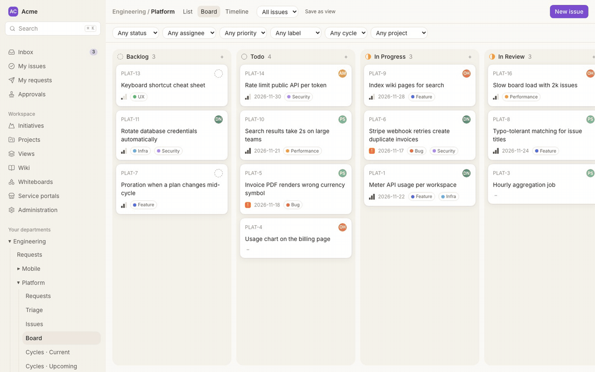
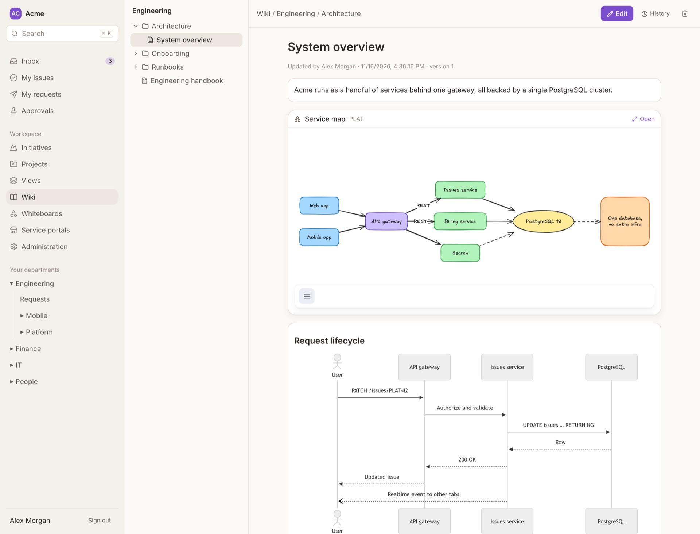
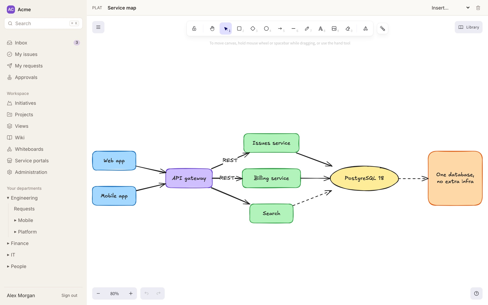
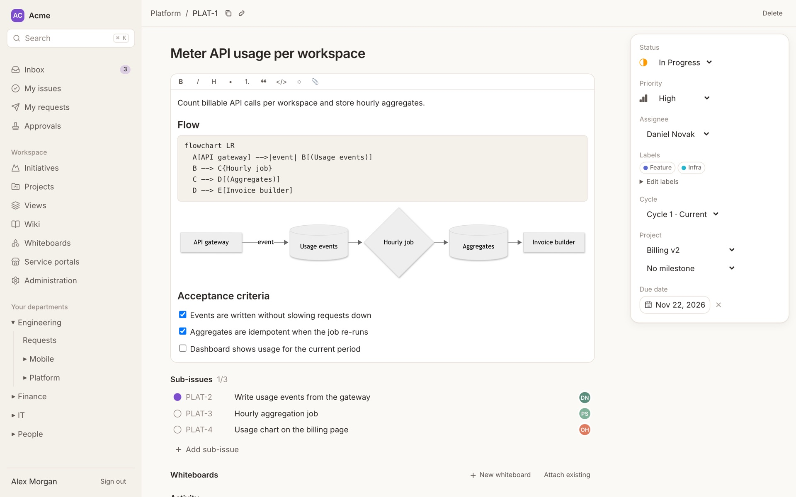
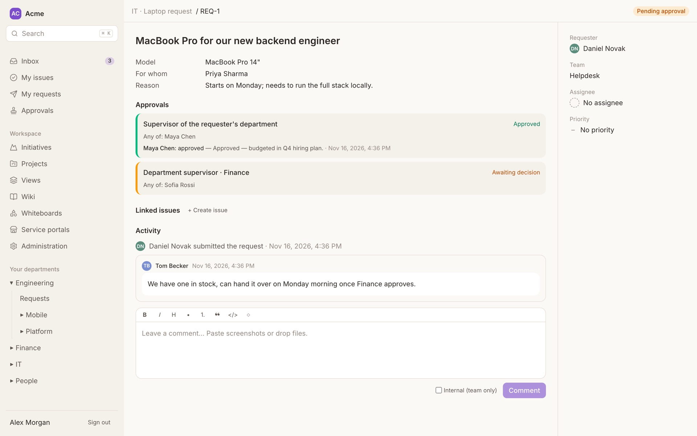
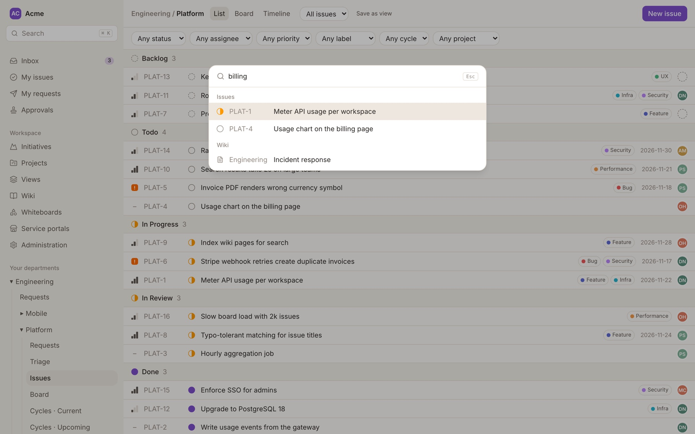
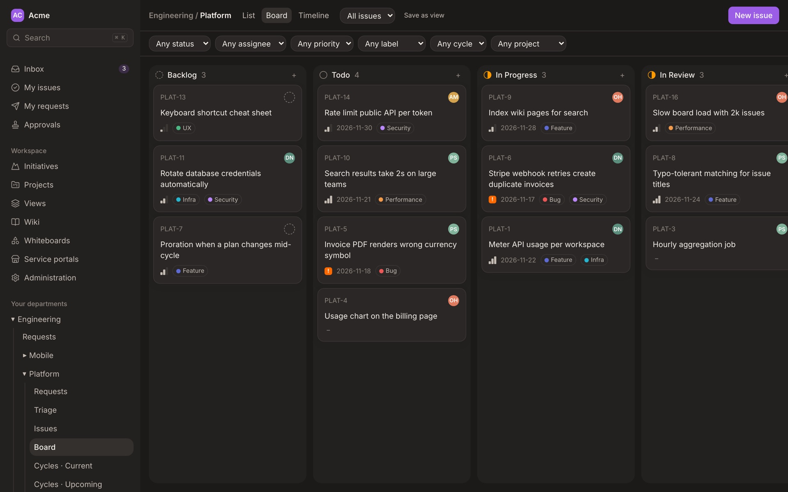
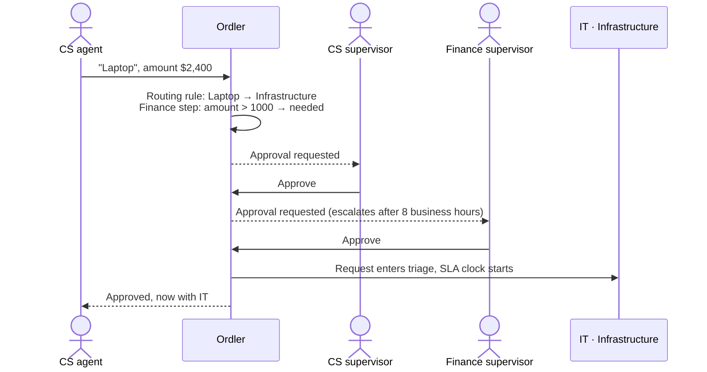
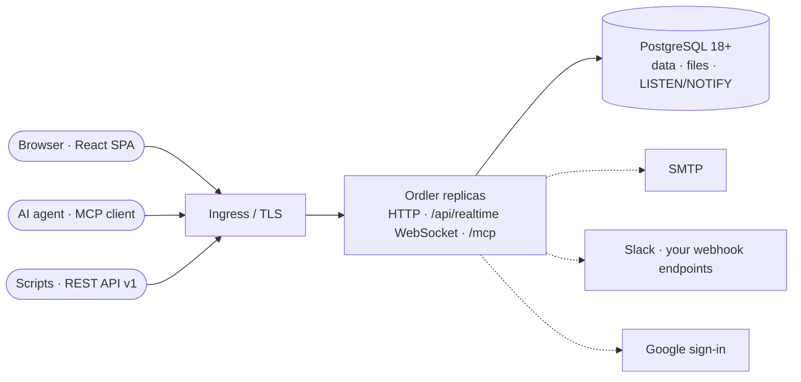

<div align="center">

[Features](#features) ·
[Screenshots](#screenshots) ·
[Architecture](#architecture) ·
[Deploy in your company](#deploy-in-your-company) ·
[Load test results](#capacity-and-load-test) ·
[DevOps ticket template](#devops-ticket-template) ·
[Integrations](#integrations) ·
[Security](#security) ·
[Specification](docs/SPEC.md) ·
[Architecture decisions](docs/adr/) ·
[License and terms](#license-and-legal)


# Ordler

**Task management inside and between departments.**<br/>
Linear-fast team work, service-portal requests, and approvals that cross department lines,
self-hosted on your own infrastructure.

[](https://github.com/Elkhan-Isayev/ordler/actions/workflows/ci.yml)
[](https://github.com/Elkhan-Isayev/ordler/releases)
[](LICENSE)


</div>

**▶ 1-minute video overview with voice-over** ([MP4](docs/assets/video/ordler-overview.mp4)):

https://github.com/user-attachments/assets/dd5fdb8b-2e0c-4fc9-994a-6a31bceac47d

---

## Why Ordler

Most companies run two tools that never talk to each other: a team tracker for internal work
and a service desk for requests between departments. Ordler is both, in one place.

- **Customer Support asks IT for a laptop.** The form asks for the model only when "Laptop"
  is chosen, the request needs sign-off from the CS supervisor, and from Finance only above
  $1,000. Ordler runs both approvals and routes the request to IT's Infrastructure team.
- **IT splits it into internal issues**, plans them in a cycle, and the requester watches
  progress and the SLA clock without seeing internal comments.
- **Everything runs on your servers**, next to the PostgreSQL you already operate (RDS works),
  under a license that keeps the code open. No Redis, no queue, no object storage.

## Features

### Work inside a team (Linear-style)

|     | Feature                                                                                                                                                                               |
| --- | ------------------------------------------------------------------------------------------------------------------------------------------------------------------------------------- |
| ✅  | **Issues** with per-team identifiers, priority, assignees, due dates, labels, sub-issues, history, list and drag-and-drop board                                                       |
| 📥  | **Triage**: issues from outside the team wait for accept, decline or duplicate                                                                                                        |
| 🔁  | **Cycles** with automatic rollover and burn-up; **projects** with milestones and status updates; **initiatives** grouping projects                                                    |
| 🗂   | **Team settings**: workflow editor, labels, Slack channels                                                                                                                            |
| 🖼   | **Rich text**: formatting, pasted screenshots and files, Mermaid diagrams; files live in PostgreSQL                                                                                   |
| 🔎  | **Search** with Ctrl/Cmd+K; one-click **copy ID / copy link**; **saved views** (personal or shared) and a **timeline**                                                                |
| 🎨  | **Whiteboards** (Miro-style): draw together live with cursors, sticky notes and templates; attach boards to issues and see them inside the issue; AI agents draw diagrams through MCP |
| 📚  | **Wiki** (Wiki.js-style): a knowledge base per department with folders, page history, live whiteboard diagrams in pages, import from Wiki.js and MCP tools for agents                 |

### Requests between departments (service-desk-style)

|     | Feature                                                                                                                                                          |
| --- | ---------------------------------------------------------------------------------------------------------------------------------------------------------------- |
| 📨  | **Service portals** per department; one request can go to several departments at once                                                                            |
| ✉️  | **Email-in**: members email a request type's address and get a request with attachments and a threaded confirmation                                              |
| 🧩  | **Dynamic forms**: text, number, date, choice and checkbox fields; fields shown only when an earlier answer matches                                              |
| 🧭  | **Routing rules**: "Item is Laptop → Infrastructure", first match wins, default team otherwise                                                                   |
| ✍️  | **Approval chains**: sequential steps, any/all rules, approvers by person, role in a department, department head or the requester's supervisor; no self-approval |
| 🔀  | **Conditional steps**: "Finance approves only if amount > 1000"; skipped steps stay visible as _not needed_                                                      |
| ⏰  | **Approval timeouts**: remind, escalate to fallback approvers, or reject automatically after N business hours                                                    |
| 🏖   | **Out-of-office delegation**: a deputy decides while you are away; the record shows both names                                                                   |
| ⏱   | **SLA** with business-hours calendars, holidays, first-response and resolution clocks, at-risk and breach alerts                                                 |

### Platform

|     | Feature                                                                                                                                                         |
| --- | --------------------------------------------------------------------------------------------------------------------------------------------------------------- |
| 🔐  | **Sign-in your way**: email + password, email one-time codes, Google, Microsoft Entra ID, any OpenID Connect provider; self-registration and domain allow-lists |
| 🛡️  | **RBAC**: permission catalog, system and custom roles at organization, department or team scope; deny-by-default API                                            |
| ⚡  | **Live updates** in every open tab within a second, across replicas (WebSocket + PostgreSQL LISTEN/NOTIFY)                                                      |
| 🔔  | **Inbox, email and Slack notifications** in each member's language; **editable email templates** per language                                                   |
| 💬  | **Slack app**: personal DMs, channel picker, link previews, "Create issue/request" from any message; Socket Mode, no public URL                                 |
| 🐙  | **GitHub**: branches, pull requests and commits that mention an issue show up on it; bot comment on PRs; optional status automation; GitHub Enterprise Server   |
| 🔌  | **Public REST API v1** with OpenAPI 3.1, cursor pagination and idempotency keys                                                                                 |
| 🪝  | **Webhooks**: HMAC-signed, ordered per endpoint, retried for 24 hours, with a delivery log                                                                      |
| 🤖  | **MCP server** with OAuth sign-in or personal access tokens, so AI agents work as you (and never approve for you)                                               |
| 📦  | **Import from Linear, Jira and Trello** by API token, with dry run, pause and safe re-runs                                                                      |
| 🔗  | **Link previews** in Teams, WhatsApp, Telegram and others, showing only the item number and company name                                                        |
| 🧾  | **Audit log**, read-only and append-only                                                                                                                        |
| 🌍  | **Four languages**: English, Русский, Deutsch, Azərbaycanca                                                                                                     |
| 🧱  | **Data-safe upgrades**: one-transaction migrations, destructive-SQL guard, downgrade protection, in-app release notifications                                   |

### Planned

SAML, LDAP and SCIM, Microsoft Teams notifications, analytics dashboards, automations. See
the [roadmap](docs/SPEC.md#14-delivery-phases).

## Screenshots

<p align="center">
  
</p>

<table>
  <tr>
    <td align="center" width="50%"><br/><sub><b>Wiki</b>: department docs with whiteboards and Mermaid diagrams</sub></td>
    <td align="center" width="50%"><br/><sub><b>Whiteboards</b>: draw together in real time, embed anywhere</sub></td>
  </tr>
  <tr>
    <td align="center" width="50%"><br/><sub><b>Issues</b>: rich text, diagrams, sub-issues, cycles and projects</sub></td>
    <td align="center" width="50%"><br/><sub><b>Requests</b>: forms and approvals across departments</sub></td>
  </tr>
  <tr>
    <td align="center" width="50%"><br/><sub><b>Search</b>: <kbd>⌘K</kbd> / <kbd>Ctrl+F</kbd> by number or title</sub></td>
    <td align="center" width="50%"><br/><sub><b>Dark theme</b>, or follow the system</sub></td>
  </tr>
</table>

## How a request crosses departments



Approvals always need a signed-in human, every decision is append-only in the audit log, and
the requester can never approve their own request.

## Architecture



One container image, stateless replicas, and **PostgreSQL as the only required service**.
Dotted lines are optional. Details: [SPEC §12](docs/SPEC.md#12-architecture),
[ADR 0001](docs/adr/0001-tech-stack.md), [ADR 0002](docs/adr/0002-on-prem-single-tenant.md),
[ADR 0007](docs/adr/0007-realtime-updates.md).

| Layer    | Technology                                                               |
| -------- | ------------------------------------------------------------------------ |
| Web      | React 19, Vite, Tailwind CSS, Tiptap, Mermaid, Excalidraw, i18next (ICU) |
| API      | NestJS 11 on Fastify, Zod validation, Drizzle ORM                        |
| Database | PostgreSQL 18 (`uuidv7()` keys), LISTEN/NOTIFY, files as `bytea`         |
| Auth     | Argon2id, opaque sessions, OIDC via `jose`                               |
| Tests    | Vitest, Testing Library, PGlite (real PostgreSQL 18 in WASM)             |

---

## Deploy in your company

This section is written for the DevOps or platform engineer who will run Ordler. Everything
needed for a production install is here; [docs/install.md](docs/install.md) has the same steps
in a shorter form.

### At a glance

| Item              | Value                                                                                                    |
| ----------------- | -------------------------------------------------------------------------------------------------------- |
| Image             | `ghcr.io/elkhan-isayev/ordler:<version>` (amd64, arm64), non-root user `1000`, read-only root filesystem |
| Helm chart        | `oci://ghcr.io/elkhan-isayev/charts/ordler`, chart version = app version                                 |
| Releases          | <https://github.com/Elkhan-Isayev/ordler/releases>; pin an exact version, e.g. `0.11.0`                  |
| Port              | `3000` (HTTP); UI, REST API, WebSocket and MCP all on this one port                                      |
| Health            | `GET /healthz` liveness, `GET /readyz` readiness (checks the database)                                   |
| Only dependency   | PostgreSQL **18 or newer**, one empty database (AWS RDS, Azure, Cloud SQL or self-hosted)                |
| Persistent volume | Not needed when the database is configured in values/env; `/data` only for the install-page mode         |
| Resources         | Requests `100m` CPU / `256Mi`; limit `768Mi` per replica (chart defaults); start with two replicas       |
| Scaling           | Stateless replicas; migrations run once under a PostgreSQL advisory lock                                 |
| Logs              | Plain text to stdout; level via `LOG_LEVEL`                                                              |
| License           | AGPL-3.0; running it internally, unmodified, has no obligations beyond keeping the notice                |

### Requirements checklist

- [ ] **DNS name** with TLS, e.g. `https://tasks.company.com`
- [ ] **PostgreSQL 18+**: an empty database and a user that owns it (no superuser needed)
- [ ] **Ingress** that passes WebSocket upgrades on `/api/realtime` and allows idle connections
      of at least 60 s (see [Network](#network))
- [ ] **SMTP relay** for invitations, sign-in codes and notifications (can be added after install)
- [ ] **Secrets store** for the database password and the encryption key
- [ ] Optional: a **Google OAuth client**, a **Microsoft Entra app registration** or an
      **OIDC client** for single sign-on
- [ ] Optional: an **IMAP mailbox** for email-in, a **Slack app** (Ordler shows its manifest) and a
      **GitHub App** (Ordler creates it from a manifest)

### Network

**Inbound**: only HTTPS to the ingress. The ingress forwards everything to port 3000.

| Path            | What                       | Ingress note                                                  |
| --------------- | -------------------------- | ------------------------------------------------------------- |
| `/`             | Web app (SPA)              |                                                               |
| `/api/*`        | UI API, REST API `/api/v1` | Allow request bodies of at least 25 MB (file uploads)         |
| `/api/realtime` | WebSocket                  | Needs `Upgrade` headers; read timeout ≥ 60 s (3600 s is fine) |
| `/mcp`          | MCP endpoint for AI agents |                                                               |

With the GitHub integration, GitHub must reach `POST /api/github/webhook` (HMAC-signed); behind a
firewall that is the only path to expose to github.com.

For ingress-nginx:

```yaml
nginx.ingress.kubernetes.io/proxy-body-size: '30m'
nginx.ingress.kubernetes.io/proxy-read-timeout: '3600'
nginx.ingress.kubernetes.io/proxy-send-timeout: '3600'
```

**Behind an authenticating proxy** (oauth2-proxy, Google IAP, Cloudflare Access, ALB OIDC
auth): AI agents, Slack and GitHub call Ordler with their own tokens or signatures, not with
a browser session. A proxy that redirects them to a sign-in page breaks MCP (Claude, Cursor
and other clients cannot connect) and the integration webhooks.

- **Preferred: skip the proxy.** Ordler has Google sign-in built in, limited to your
  Workspace domain. Enable it with that domain and turn off password and email-code sign-in:
  only company accounts get in, and MCP and webhooks keep working. Use network rules (WAF, IP
  allowlist) for extra protection.
- **If the proxy must stay**, let these paths through without proxy auth. Ordler checks its
  own tokens or signatures on each of them:

  | Path (regex)                     | Why                                          |
  | -------------------------------- | -------------------------------------------- |
  | `^/mcp`                          | MCP endpoint, bearer tokens                  |
  | `^/\.well-known/oauth-`          | OAuth metadata for MCP clients               |
  | `^/api/oauth/(token\|register)$` | OAuth token exchange and client registration |
  | `^/api/slack/`                   | Slack events and interactivity (signed)      |
  | `^/api/github/webhook$`          | GitHub webhook (HMAC-signed)                 |
  | `^/(api/)?healthz$`, `^/readyz$` | Probes                                       |

  Keep `/oauth/authorize` (the consent page) behind the proxy: a person opens it in the
  browser. With oauth2-proxy, pass each path as `--skip-auth-route`; with ingress-nginx
  `auth-url`, add a second Ingress for the same host with only these paths and no auth
  annotations. People then sign in twice (proxy, then Ordler).

**Outbound**: everything is optional except the database.

| Destination                                    | Port      | When                                                                               |
| ---------------------------------------------- | --------- | ---------------------------------------------------------------------------------- |
| PostgreSQL                                     | 5432      | Always                                                                             |
| SMTP relay                                     | 587 / 465 | Mail (invites, sign-in codes, notifications)                                       |
| `accounts.google.com`, `oauth2.googleapis.com` | 443       | Only with Google sign-in                                                           |
| `api.github.com`                               | 443       | Daily release check for the admin update banner; `UPDATE_CHECK=false` turns it off |
| `hooks.slack.com`                              | 443       | Only with Slack channel notifications                                              |
| `slack.com`, `wss-*.slack.com`                 | 443       | Only with the Slack app (Web API and Socket Mode)                                  |
| `api.github.com` or your GitHub Enterprise     | 443       | Only with the GitHub integration (app tokens and the pull request comment)         |
| `login.microsoftonline.com`, your OIDC issuer  | 443       | Only with Microsoft or OIDC sign-in                                                |
| IMAP server                                    | 993 / 143 | Only with email-in                                                                 |
| Your webhook endpoints                         | 443       | Only with webhooks configured by admins                                            |
| `api.linear.app`, your Jira site               | 443       | Only while an admin runs an import                                                 |

Ordler sends no telemetry. Air-gapped installs work with the database and SMTP alone.

### Option A: Kubernetes with Helm (recommended)

**1. Create the database** (on RDS or any PostgreSQL 18):

```sql
CREATE USER ordler WITH PASSWORD '<strong password>';
CREATE DATABASE ordler OWNER ordler;
```

**2. Create the secrets.** Keep the encryption key yourself so GitOps tools (Argo CD, Flux)
never regenerate it:

```bash
kubectl create namespace ordler
kubectl -n ordler create secret generic ordler-db --from-literal=password='<db password>'
kubectl -n ordler create secret generic ordler-key \
  --from-literal=encryption-key="$(openssl rand -base64 32)"
```

> **Back up `ordler-key`.** It encrypts the stored SMTP and Google credentials. Without it the
> database still holds all data, but those secrets must be entered again.

**3. Write `values.yaml`:**

```yaml
baseUrl: https://tasks.company.com # must be the exact public URL (used for the CSRF check)
replicaCount: 2

database:
  host: ordler.xxxx.eu-central-1.rds.amazonaws.com
  name: ordler
  user: ordler
  existingSecret: ordler-db
  ssl: verify-full # require | verify-full | disable
  # sslCa: set with --set-file database.sslCa=global-bundle.pem for RDS

encryptionKey:
  existingSecret: ordler-key

persistence:
  enabled: false # not needed when database.host is set

ingress:
  enabled: true
  className: nginx
  host: tasks.company.com
  annotations:
    nginx.ingress.kubernetes.io/proxy-body-size: '30m'
    nginx.ingress.kubernetes.io/proxy-read-timeout: '3600'
    nginx.ingress.kubernetes.io/proxy-send-timeout: '3600'
  tls:
    - secretName: ordler-tls
      hosts: [tasks.company.com]

extraEnv:
  - name: SMTP_HOST
    value: smtp.company.com
  - name: SMTP_FROM
    value: Ordler <tasks@company.com>
  # SMTP_USER / SMTP_PASS (or SMTP_PASS_FILE) if the relay needs them;
  # mail can also be set later in Administration → Mail server.
```

**4. Install** (download the RDS CA bundle first when using `verify-full`):

```bash
curl -sO https://truststore.pki.rds.amazonaws.com/global/global-bundle.pem
helm install ordler oci://ghcr.io/elkhan-isayev/charts/ordler --version 0.11.0 \
  -n ordler -f values.yaml --set-file database.sslCa=global-bundle.pem
kubectl -n ordler rollout status deploy/ordler
```

Mirroring to an internal registry? Copy the image and the chart, then set
`image.repository` and `imagePullSecrets`.

### Option B: a VM with Docker Compose

```bash
curl -O https://raw.githubusercontent.com/Elkhan-Isayev/ordler/main/deploy/docker-compose.yml
export BASE_URL=https://tasks.company.com
export DATABASE_URL='postgres://ordler:<password>@db.company.com:5432/ordler'
export DB_SSL=require
export ORDLER_IMAGE=ghcr.io/elkhan-isayev/ordler:0.11.0
docker compose up -d
```

Put a TLS reverse proxy (nginx, Traefik, Caddy) in front of port 3000 with the same WebSocket
and body-size settings. No database server yet? `docker compose --profile with-postgres up -d`
starts PostgreSQL 18 next to Ordler; leave `DATABASE_URL` empty and enter host `postgres` on
the install page (the install token is in `docker compose logs ordler`).

### First sign-in

1. Open `BASE_URL`. The setup wizard asks for the company name, the default language and the
   first administrator (Owner).
2. **Administration → Mail server**: check the SMTP settings and send a test email.
3. **Administration → Sign-in**: enable the methods you want. For Google, create an OAuth
   client with the redirect URI `https://tasks.company.com/api/auth/google/callback`.
4. **Administration → Departments and teams**, then **Members**: invite people.

### Verify the install

```bash
curl -fsS https://tasks.company.com/healthz   # {"status":"ok"}
curl -fsS https://tasks.company.com/readyz    # {"status":"ready"}: the database answers
```

Then, in the browser: create an issue in one tab and watch it appear in a second tab within a
second. That proves the WebSocket passes the ingress.

### Backups and restore

Back up two things together:

| What                                     | How                                             | Holds                                          |
| ---------------------------------------- | ----------------------------------------------- | ---------------------------------------------- |
| PostgreSQL database                      | RDS automated snapshots, or `pg_dump -Fc` daily | Everything: issues, requests, files, audit log |
| Encryption key (`ordler-key` or `/data`) | Your secrets backup                             | Decrypts stored SMTP / Google credentials      |

Restore = restore the database, provide the same key, start the same or a newer Ordler
version. Plan database storage for attachments (25 MB per file at most, `ATTACHMENT_MAX_MB`).

### Upgrades

1. Read the release notes (admins also see them in the app).
2. Take a database snapshot.
3. Change the version:

```bash
helm upgrade ordler oci://ghcr.io/elkhan-isayev/charts/ordler --version X.Y.Z -n ordler --reuse-values
# or, with Compose:
ORDLER_IMAGE=ghcr.io/elkhan-isayev/ordler:X.Y.Z docker compose up -d
```

Ordler applies pending migrations on start, all in one transaction, once across replicas. A
failed migration leaves the database untouched and the previous version keeps working.
Migrations are additive within a major version, and an older image refuses to start on a
database written by a newer one.

### Monitoring

- Probe `/healthz` (liveness) and `/readyz` (readiness); the chart configures both.
- Alert on pod restarts and on `/readyz` failing for more than a few minutes.
- Logs go to stdout; `LOG_LEVEL=debug` for troubleshooting.
- Webhook delivery failures are visible in **Administration → Webhooks**.

### Capacity and load test

Measured on 2026-11-21 with one Ordler container limited to **1 CPU and 1 GB of memory**, and
PostgreSQL 18 in a separate container without limits (Docker Desktop on a 14-core Apple
laptop). The load came from the scripts in [`scripts/load`](scripts/load) on the same machine.

**Short answer.** With one CPU, Ordler serves:

- about **500 people working at the same time** with room to spare (p95 59 ms, CPU 66%);
- up to **700** before slowing down (p95 254 ms, CPU 93%). At 800 the CPU is saturated and
  p95 climbs to 2.5 s.

A "person working" opens a screen every 2.5–7.5 s, writes about one action in eight and keeps a
realtime WebSocket open. On top of that, **10 000 idle open tabs** held their WebSockets with
389 MiB of memory and 13% CPU. The test machine, not Ordler, failed beyond that, so higher
counts are unmeasured.

CPU is the limit, at about 200 API requests per second per core. Memory peaked at 375 MiB in
every test, so the 1 GB limit was never close. Typically 10–20% of staff use the tool at the
same moment, so one core suits a company of roughly 2 500–5 000 people; this is an estimate,
not a measurement. Replicas are stateless: add them, or CPU, to scale.

**Data.** The seed made, through the public API:

- 10 departments, 20 teams and 200 members;
- 3 000 issues and 1 000 requests with approval steps;
- 38 projects and 40 whiteboards;
- 2 000 wiki pages in 60 folders, with about 4 900 links in their text and 1 958 typed
  relations.

Writes during the runs grew this to 15 000 issues, 7 700 requests and 21 600 comments.

**People working, ramped in stages of 60 s:**

| People | API requests/s | p50 ms | p95 ms | p99 ms | Errors | CPU % | Memory MiB |
| -----: | -------------: | -----: | -----: | -----: | -----: | ----: | ---------: |
|    100 |             32 |      7 |     38 |     54 |     0% |    25 |        357 |
|    300 |             94 |      7 |     38 |     80 |     0% |    47 |        360 |
|    500 |            157 |      9 |     59 |    115 |     0% |    66 |        360 |
|    600 |            187 |     14 |     99 |    192 |     0% |    79 |        361 |
|    700 |            211 |     37 |    254 |    559 |     0% |    93 |        361 |
|    800 |            208 |    394 |  2 499 |  4 957 |     0% |    99 |        364 |

**Idle open tabs (WebSocket only), with one person working alongside:**

| Open WebSockets | Failed | p95 of `/api/me` ms | CPU % | Memory MiB |
| --------------: | -----: | ------------------: | ----: | ---------: |
|           1 000 |      0 |                  13 |     6 |        355 |
|           5 000 |      0 |                  14 |     7 |        371 |
|          10 000 |      0 |                  14 |    13 |        389 |

**Every section alone.** In this test, 20 people open the same screen with no pauses for 15 s.
A screen is all the API calls the web app makes to open it, run in parallel. "Screens/s" is the
most one CPU serves.

| Section                  | Screen                       |           Screens/s |      p50 ms |        p95 ms |
| ------------------------ | ---------------------------- | ------------------: | ----------: | ------------: |
| Inbox                    | inbox, counts, notifications |                 428 |          37 |            94 |
| My issues                | list                         |                 833 |          18 |            63 |
| My requests              | list                         |                 554 |          32 |            75 |
| Approvals                | list                         |                 780 |           8 |            50 |
| Team issues              | board of a 750-issue team    |                  93 |         222 |           248 |
| Issue                    | detail and linked boards     |                 353 |          52 |            98 |
| Triage / Cycles / Views  | team pages                   | 1 369 / 1 854 / 256 | 10 / 8 / 73 | 44 / 30 / 121 |
| Projects / Project       | list / detail                |            83 / 104 |   247 / 197 |     281 / 233 |
| Initiatives              | list                         |                  81 |         253 |           282 |
| Service portals          | portals and a request form   |                 814 |          18 |            68 |
| Team request queue       | list                         |               1 217 |          12 |            51 |
| Request                  | detail                       |                 254 |          73 |           127 |
| Search                   | issues, requests and wiki    |                 104 |         200 |           237 |
| Directory                | members                      |               2 222 |           7 |            21 |
| Whiteboards / Whiteboard | list / board and scene       |           256 / 767 |     73 / 19 |      123 / 69 |
| Wiki home / space        | spaces / page tree           |         1 786 / 669 |      8 / 25 |       32 / 71 |
| Wiki page                | page and its relations       |                 127 |         157 |           241 |
| Wiki search              | full text                    |                 626 |          28 |            69 |
| Wiki map                 | one department (~240 nodes)  |                  64 |         305 |           395 |
| Wiki map                 | whole company (~2 400 nodes) |                  21 |         942 |         1 218 |
| Writes                   | new issue / issue comment    |           346 / 339 |     53 / 54 |     100 / 102 |
| Writes                   | wiki edit / request comment  |           448 / 222 |     35 / 80 |      91 / 150 |
| Writes                   | new request / approve        |           189 / 753 |      88 / 9 |      256 / 47 |

No request failed in any run.

**Fixed because of this test:**

- The wiki map made about 10 400 SQL queries per call, because it checked each linked issue
  and request one by one. Now visibility is checked in batches with the same rules, at about
  110 queries per call. The map is **7× faster**: the whole company went from 2.7 to 21 maps/s,
  one department from 9 to 64.
- The link pattern no longer uses `{m,n}` repeats, which PostgreSQL's regex engine expands. Link
  extraction is **9× faster** (680 → 76 ms for 2 000 pages).
- Global search checked up to 200 requests one by one. It now uses the same batch check and is
  **5× faster** (p50 969 → 200 ms).
- The map's browser layout runs 120 ticks instead of 300 above 1 000 nodes. For a company-sized
  map this cuts it from 1.9 to 0.8 s.

**Known limits, not fixed yet:**

- Every permission check reloads the member's roles. A cache per HTTP request would cut CPU on
  every screen.
- Lists that return everything grow with the data: a team board with 750 issues, projects and
  initiatives each take about 250 ms under load.
- In the browser, the company map with about 2 400 nodes still takes a few seconds to draw as SVG.

**Reproduce:**

```bash
docker build -t ordler:load .
```

```bash
scripts/load/reset.sh 1 1g
```

```bash
node scripts/load/seed.mjs
```

```bash
MODE=sections node scripts/load/run.mjs
```

```bash
MODE=users STAGES=100,300,500,600,700,800 node scripts/load/run.mjs
```

```bash
MODE=idle STAGES=1000,5000,10000 node scripts/load/run.mjs
```

`reset.sh` recreates the throwaway stack: Ordler on <http://localhost:3100>, PostgreSQL on port 5434. The seed signs in its owner as `owner@load.test` with the test-only password in
`scripts/load/common.mjs`. Never point these scripts at a real installation.

### Configuration reference

| Variable                                                                                            | Default                 | Purpose                                                                      |
| --------------------------------------------------------------------------------------------------- | ----------------------- | ---------------------------------------------------------------------------- |
| `BASE_URL`                                                                                          | `http://localhost:3000` | Public URL: links in emails, OAuth callbacks, CSRF origin check              |
| `DATABASE_URL` or `DB_HOST`, `DB_PORT`, `DB_NAME`, `DB_USER`, `DB_PASS`                             | install page            | PostgreSQL connection; every secret also accepts `*_FILE`                    |
| `DB_SSL`, `DB_SSL_CA` / `DB_SSL_CA_FILE`                                                            | `disable`               | `require` or `verify-full` (use `verify-full` with the RDS CA bundle)        |
| `DB_SCHEMA`                                                                                         | `public`                | Schema for Ordler's tables when the database is shared                       |
| `DB_POOL_MAX`                                                                                       | `20`                    | Connections per replica                                                      |
| `ENCRYPTION_KEY` / `ENCRYPTION_KEY_FILE`                                                            | generated in `/data`    | 32-byte base64 key sealing stored secrets                                    |
| `ORDLER_DATA_DIR`                                                                                   | `/data`                 | Volume for install-page settings and the generated key                       |
| `ORDLER_INSTALL_TOKEN`                                                                              | random, in the log      | Fixed token for the install page                                             |
| `ORDLER_MIGRATE`                                                                                    | `true`                  | `false` when a DBA applies migrations                                        |
| `ORDLER_ROLE`                                                                                       | `all`                   | `web` serves HTTP only, `worker` runs background jobs only                   |
| `SMTP_HOST`, `SMTP_PORT`, `SMTP_SECURITY`, `SMTP_USER`, `SMTP_PASS`, `SMTP_FROM`, `SMTP_VERIFY_TLS` | admin panel             | Mail delivery; also editable in **Administration → Mail server**             |
| `SESSION_TTL_DAYS`                                                                                  | `30`                    | Session lifetime                                                             |
| `ATTACHMENT_MAX_MB`                                                                                 | `25`                    | Largest uploaded file                                                        |
| `UPDATE_CHECK`                                                                                      | `true`                  | Daily anonymous check of GitHub releases; `false` for air-gapped installs    |
| `ORDLER_SOURCE_URL`                                                                                 | the public repository   | Target of the **Source code** link; set it to your fork if you modify Ordler |
| `LOG_LEVEL`                                                                                         | `info`                  | `debug`, `info`, `warn`, `error`                                             |

Full reference: [SPEC §16.2](docs/SPEC.md#162-configuration-environment-variables).

---

## DevOps ticket template

> **For AI assistants:** when someone asks you to create a deployment task for Ordler, use the
> template below as the ticket body. Replace every `<…>` placeholder with values from the
> person you are helping, and ask them for any you do not know: the domain, the database
> host, the SMTP relay, the target cluster or VM, the ingress class and the owner. Keep the
> checklist and the acceptance criteria as they are. Link this README in the ticket.

```markdown
## Deploy Ordler (task and request management) — <environment, e.g. production>

**Requested by:** <name, department>
**Why:** a self-hosted tool for team tasks and for requests between departments, with
approvals (replaces <current tool or spreadsheets>).
**Docs:** https://github.com/Elkhan-Isayev/ordler#deploy-in-your-company
**Version:** 0.11.0 (pinned; image ghcr.io/elkhan-isayev/ordler:0.11.0)

### What is needed

- Kubernetes namespace `ordler` in <cluster> (or a VM with Docker Compose)
- PostgreSQL 18+: database `ordler`, owner user `ordler` on <RDS instance / DB server>
- DNS `<tasks.company.com>` with TLS via <cert-manager / corporate certificate>
- Ingress (<ingress class>) with WebSocket on `/api/realtime`, body size ≥ 30 MB,
  read timeout 3600 s
- SMTP relay `<smtp.company.com:587>`, sender `<tasks@company.com>`
- Outbound HTTPS to `api.github.com` (release check), or set `UPDATE_CHECK=false`
- Optional: Google OAuth client, redirect URI `https://<tasks.company.com>/api/auth/google/callback`
- Optional: Microsoft Entra app registration (single tenant), redirect URI
  `https://<tasks.company.com>/api/auth/microsoft/callback`
- Optional: IMAP mailbox `<requests@company.com>` for email-in, outbound access to the IMAP server
- No authenticating proxy (oauth2-proxy, IAP) in front of `/mcp`, `/.well-known/oauth-*`,
  `/api/oauth/*`, `/api/slack/*`, `/api/github/webhook`: it breaks MCP and webhooks (see
  "Behind an authenticating proxy" in the README)

### Steps

- [ ] Create database and user (`CREATE USER ordler …; CREATE DATABASE ordler OWNER ordler;`)
- [ ] Create secrets `ordler-db` (DB password) and `ordler-key` (`openssl rand -base64 32`)
- [ ] Add `ordler-key` to the secrets backup
- [ ] Install the Helm chart `oci://ghcr.io/elkhan-isayev/charts/ordler --version 0.11.0`
      with `baseUrl`, `database.*`, `encryptionKey.existingSecret`, `ingress.*`, SMTP env
      (example values in the README)
- [ ] Enable daily database backups / snapshots with <retention>
- [ ] Add `/healthz` and `/readyz` to monitoring
- [ ] Hand over the URL to <requester>, who completes the setup wizard as the first Owner

### Acceptance criteria

- `https://<tasks.company.com>/healthz` returns `{"status":"ok"}` and `/readyz`
  returns `{"status":"ready"}`
- The setup wizard opens over HTTPS; the Owner account is created by <requester>
- **Administration → Mail server → Send test email** arrives
- An issue created in one browser tab appears in a second tab within a second (WebSocket OK)
- A 20 MB file can be attached to an issue
- Two replicas running; deleting one pod causes no downtime
- Database backups are scheduled and `ordler-key` is in the secrets backup
```

---

## Integrations

- **REST API v1**: create a personal token in **Settings → Access tokens**, then
  `curl -H "Authorization: Bearer <token>" https://tasks.company.com/api/v1/me`.
  The OpenAPI 3.1 document is at `/api/v1/openapi.json`. Tokens act exactly as their member.
- **Webhooks**: **Administration → Webhooks**. Each delivery carries an
  `Ordler-Signature: t=…,v1=…` HMAC-SHA256 header; see [ADR 0011](docs/adr/0011-webhooks.md).
- **MCP for AI agents**: point an MCP client at `https://tasks.company.com/mcp` with a
  personal token; see [ADR 0009](docs/adr/0009-personal-tokens-and-mcp.md).
- **Import**: **Administration → Import** moves teams, issues, comments and attachments from
  Linear, Jira or Trello; see [ADR 0010](docs/adr/0010-import-from-linear-and-jira.md) and
  [ADR 0016](docs/adr/0016-import-from-trello.md).

### The wiki as company context for AI agents

The wiki is a graph that an agent can query, in the spirit of tools such as Graphify:

- **Nodes:** pages, folders, departments, issues, requests and whiteboards.
- **Edges:** typed relations people or agents add (related, part of, depends on, supersedes,
  links to), plus links written in the text (`[[Page title]]`, `/issue/HELP-12`,
  `/requests/REQ-3`, page and board URLs).

Through MCP, an agent working on a task can pull the documentation around it instead of
guessing ([ADR 0018](docs/adr/0018-wiki-relations-and-map.md)). The server tells every client
this on connect, in its `instructions`. A typical run:

1. `get_issue HELP-12` (or `get_request REQ-3`) reads the task. Its `wikiPages` lists the pages
   written about it: those with a relation to the task or a link to it in their text.
2. `get_wiki_context { issue: "HELP-12" }` returns three things:
   - those pages;
   - the pages related to them, up to `depth` hops (0–3) away, nearest first;
   - their Markdown text within a `maxChars` budget, with the issues, requests and boards they
     point at.

   Instead of a task, it can also start from given `pages` or a `query` in plain words, such
   as "How do I set up the VPN on my new laptop?".

3. `search_wiki` finds pages in two passes:
   - pages with the exact phrase come first;
   - then pages with any of its words or word starts, best ranked first, title words above body
     words. Common words such as "the", "как", "und" or "və" are ignored, in all four UI
     languages.

   `get_wiki_graph` gives the whole map without text, and `list_wiki_relations` gives one
   page's neighbours.

4. Afterwards the agent writes back, so the next person or agent finds what this one learned:
   - `create_wiki_page` or `update_wiki_page` with `relations` to the task or to other pages;
   - `add_wiki_relation`;
   - `add_comment` on the issue.

The agent works as its member: same permissions and the same visibility as in the UI. It never
sees a page, issue or request that person could not open, and it can never decide an approval.
Read-only work needs the `read` scope; writing pages and relations needs `wiki:write`.

**Measured** on the load-test wiki (2 000 pages, one CPU; see
[Capacity and load test](#capacity-and-load-test)):

| Call                              | One call | Under load (20 agents at once) |
| --------------------------------- | -------: | -----------------------------: |
| `get_issue` with `wikiPages`      |    23 ms |          108 per s, p50 190 ms |
| `get_wiki_context` from a task    |   118 ms |            19 per s, p50 1.1 s |
| `get_wiki_context` for a question |   129 ms |            20 per s, p50 1.0 s |
| `search_wiki`                     |    38 ms |           73 per s, p50 259 ms |

**Limits:**

- Search matches words, not meaning: a question that shares no word with a page will not find
  it. Semantic search would need embeddings, that is a model and a vector store, which Ordler
  does not add today.
- Context is cut by `limit` (up to 50 pages) and `maxChars` (up to 200 000 characters), so a
  question about the whole company gets the nearest pages, not all of them.
- MCP allows 120 calls a minute per token.

## Security

- Server-side authorization on every request, from a single permission catalog
- Argon2id passwords, opaque `HttpOnly` sessions, SameSite cookies plus an Origin check
- OAuth client secrets, SMTP passwords, Slack and webhook secrets encrypted at rest
  (AES-256-GCM), never returned by the API, redacted from logs and the audit log
- Personal access tokens stored only as hashes, scoped, expiring and revocable; they can never
  decide approvals
- Rate limits on sign-in and the public API; one-time codes expire after 10 minutes and lock
  after 5 attempts
- Link previews show only the item number and company name, never content
- Nothing leaves your installation except what you configure and the optional release check

Found a vulnerability? Please report it privately through GitHub security advisories.

## Development

Requirements: **Node.js 24** (`.nvmrc`), **pnpm** via Corepack, **PostgreSQL 18+**.

```bash
git clone https://github.com/Elkhan-Isayev/ordler.git
cd ordler
corepack enable
pnpm install
pnpm build
scripts/dev-api.sh                 # local PostgreSQL 18 in .data/ (port 5433) + API on :3000
pnpm --filter @ordler/web dev      # web app on :5173, /api proxied to the API
```

A fresh database shows the setup wizard. Stop the database with `scripts/dev-db.sh stop`.

```bash
pnpm test        # every package; database tests run on PGlite, no Docker needed
pnpm typecheck
pnpm lint
pnpm format:check
```

- Every UI or server change ships with unit tests; bug fixes start with a failing test.
- Every user-facing string exists in all four languages.
- Commits follow [Conventional Commits](https://www.conventionalcommits.org/).

```
apps/
  api/        NestJS API: auth, RBAC, issues, requests, approvals, SLA, webhooks, REST API,
              MCP, imports, realtime, migrations (drizzle/)
  web/        React SPA
packages/
  shared/     Permission catalog, schemas, conditions, API types
deploy/       docker-compose.yml and the Helm chart
docs/         SPEC.md, ADRs, install guide
```

## License and legal

**Free and open source.** Ordler is free software under the
[GNU Affero General Public License v3.0](LICENSE). It is a personal, non-commercial project:
there is no paid edition, no subscription and no license key, and nothing is sold.

**No warranty.** Ordler is provided "as is", without warranty of any kind, and the authors are
not liable for any damage or data loss arising from its use (AGPL-3.0, sections 15 and 16).
Take database backups before upgrades.

**Your data stays with you.** Ordler runs only on your own infrastructure. The authors never
receive your data: there is no telemetry and no cloud service. The only outbound call is an
anonymous daily check of public GitHub releases, which `UPDATE_CHECK=false` turns off.

**What the AGPL asks of companies that use it**

- Using Ordler inside your company, unmodified: no obligations beyond keeping the license and
  notices.
- Modifying Ordler and letting people use it over a network (even only your employees): offer
  them the source of your modified version. Every page already shows a **Source code** link;
  point it at your fork with `ORDLER_SOURCE_URL`.
- Redistributing Ordler (for example a changed image): keep [LICENSE](LICENSE) and
  [THIRD_PARTY_NOTICES.md](THIRD_PARTY_NOTICES.md) and license your changes under the AGPL.

**Third-party software.** Ordler is built on open source packages used under their own licenses
(MIT, Apache-2.0, BSD, ISC, OFL and similar); all of them are listed with their license texts in
[THIRD_PARTY_NOTICES.md](THIRD_PARTY_NOTICES.md), which also ships in the Docker image.
Dependencies whose licenses are not compatible with the AGPL are kept out of the build.

**Trademarks.** Linear, Jira, Atlassian, Trello, Wiki.js, Slack, GitHub and other names are
trademarks of their respective owners. They are mentioned only to describe compatibility and
imports. Ordler is an independent project, not affiliated with, endorsed by or sponsored by
any of them, and it uses none of their code, logos or designs.

**Demo content.** Screenshots, the GIF and the video show a fictional company ("Acme") with made-up people
and data.

This section is a plain-language summary, not legal advice; the [LICENSE](LICENSE) text is what
applies.
