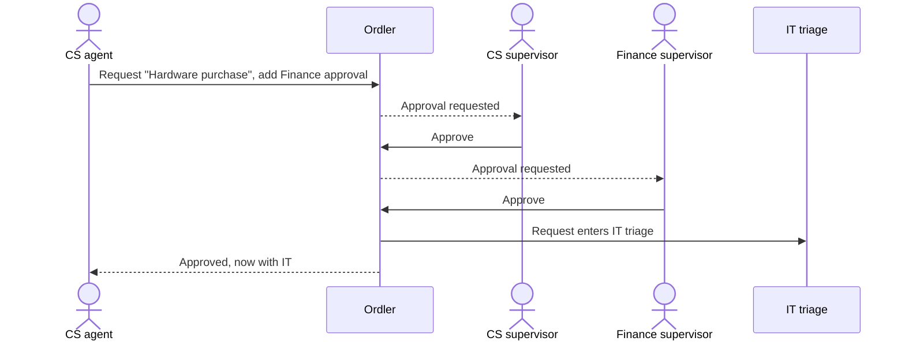
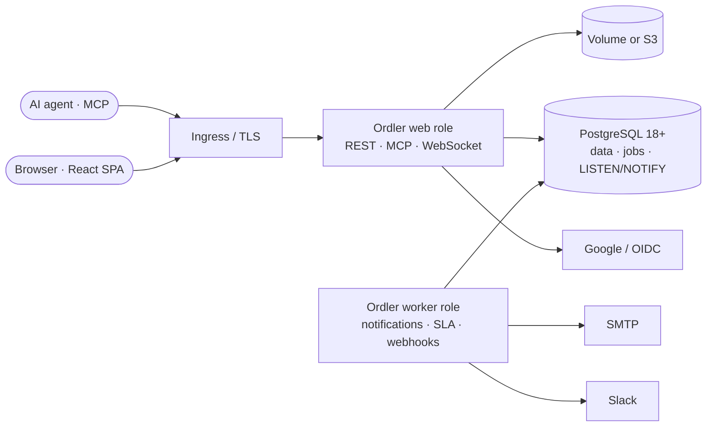

<div align="center">


# Ordler

**Task management inside and between departments.**<br/>
Linear-fast team work, service-portal requests, and approvals that cross department lines,
self-hosted on your own infrastructure.

[](https://github.com/Elkhan-Isayev/ordler/actions/workflows/ci.yml)
[](LICENSE)


[Specification](docs/SPEC.md) ·
[Architecture decisions](docs/adr/) ·
[Product map (Miro)](https://miro.com/app/board/uXjVEaKDHrU=/) ·
[Changelog](.ai/changelog/)

<br/>


</div>

---

## Why Ordler

Most companies run two tools that never talk to each other: a team tracker for internal work
and a service desk for requests between departments. Ordler is both, in one place.

- **Customer Support asks IT for headsets.** The request needs sign-off from the CS supervisor
  and from Finance. Ordler routes it through both approvals, then drops it into IT's triage.
- **IT splits it into internal issues**, ships them in a cycle, and the requester watches
  progress without seeing internal comments.
- **Everything runs on your servers**, next to the PostgreSQL you already operate (RDS works),
  under a license that keeps the code open.

## Features

|     | Feature                                                                                                                                                       | Status |
| --- | ------------------------------------------------------------------------------------------------------------------------------------------------------------- | :----: |
| 🧭  | **Setup wizard**: first run creates the workspace and the first Owner                                                                                         |   ✅   |
| 🔐  | **Sign-in your way**: email + password, email one-time codes, Google (OIDC); per-strategy self-registration and domain allow-lists, Wiki.js-style             |   ✅   |
| 🛡️  | **RBAC**: permission catalog, system and custom roles, grants at organization, department or team scope, deny-by-default API                                  |   ✅   |
| 🏢  | **Admin panel**: departments and teams, member invites with one-time links, roles per scope, team membership, sign-in methods, mail server, database, updates |   ✅   |
| 🌍  | **Four languages** from day one: English, Русский, Deutsch, Azərbaycanca                                                                                      |   ✅   |
| 🔔  | **Update notifications**: admins see new GitHub releases with step-by-step upgrade instructions                                                               |   ✅   |
| 🧱  | **Data-safe upgrades**: transactional migrations, destructive-SQL guard, downgrade protection                                                                 |   ✅   |
| 🐳  | **One Docker image, Compose and Helm chart**: needs only an empty PostgreSQL 18 database, the install page does the rest                                      |   ✅   |
| ✅  | **Team issues** (Linear-style): per-team identifiers, default workflow, priority, assignee, due date, history, list and drag-and-drop board                   |   ✅   |
| ⚡  | **Live updates**: changes appear in every open tab within a second, across replicas (WebSocket + PostgreSQL LISTEN/NOTIFY)                                    |   ✅   |
| 🖼   | **Rich text** in issues: formatting, pasted screenshots and files, Mermaid diagrams; files stored in PostgreSQL, so restarts lose nothing                     |   ✅   |
| 🗂   | **Triage, comments, labels, workflow editor, cycles**                                                                                                         |   🗓    |
| 📨  | **Service portals and requests** between departments, including several departments at once                                                                   |   🗓    |
| ✍️  | **Approval chains**: sequential steps, any/all/quorum, approvers by role, department or manager                                                               |   🗓    |
| 💬  | **Slack notifications** via webhook, later a full Slack app                                                                                                   |   🗓    |
| 🤖  | **MCP server** with personal access tokens, so AI agents work as you                                                                                          |   🗓    |

✅ shipped · 🚧 in progress · 🗓 planned for Phase 1 — see the [roadmap](docs/SPEC.md#14-delivery-phases).

## Screenshots

<table>
  <tr>
    <td align="center"><br/><sub>Admin: departments and teams</sub></td>
    <td align="center"><br/><sub>Admin: invites with one-time links, roles per scope</sub></td>
  </tr>
  <tr>
    <td align="center"><br/><sub>Admin: sign-in methods, Wiki.js-style</sub></td>
    <td align="center"><br/><sub>First-run setup wizard</sub></td>
  </tr>
</table>

## How a request crosses departments



Approvals always need a signed-in human, every decision is append-only in the audit log, and
the requester can never approve their own request.

## Architecture



One container image, stateless replicas, and **PostgreSQL as the only required service** —
no Redis, no message broker. Details: [SPEC §12](docs/SPEC.md#12-architecture) and
[ADR 0001](docs/adr/0001-tech-stack.md).

| Layer    | Technology                                                   |
| -------- | ------------------------------------------------------------ |
| Web      | React 19, Vite, Tailwind CSS, i18next with ICU MessageFormat |
| API      | NestJS 11 on Fastify, Zod validation, Drizzle ORM            |
| Database | PostgreSQL 18 (`uuidv7()` keys), pg-boss jobs, LISTEN/NOTIFY |
| Auth     | Argon2id (Node built-in), opaque sessions, OIDC via `jose`   |
| Tests    | Vitest, Testing Library, PGlite (real PostgreSQL 18 in WASM) |
| Tooling  | TypeScript strict, pnpm + Turborepo, ESLint, Prettier        |

## Getting started

Ordler needs only **PostgreSQL 18+** with an empty database; it creates its tables itself.

```bash
curl -O https://raw.githubusercontent.com/Elkhan-Isayev/ordler/main/deploy/docker-compose.yml
docker compose up -d
docker compose logs ordler   # the install token
```

Open <http://localhost:3000>, enter the database connection and the install token, then
create the workspace and the first administrator. Helm, RDS and backups:
[docs/install.md](docs/install.md).

### Development

Requirements: **Node.js 24** (`.nvmrc`), **pnpm** via Corepack, **PostgreSQL 18+**.

```bash
git clone https://github.com/Elkhan-Isayev/ordler.git
cd ordler
corepack enable
pnpm install
pnpm build
```

Start a local PostgreSQL 18 (a project-local cluster in `.data/`, port 5433; macOS with
Homebrew: `brew install postgresql@18`) and the API on port 3000:

```bash
scripts/dev-api.sh
```

It creates the database and an encryption key on first run and applies migrations. Any other
PostgreSQL 18 works too: set `DATABASE_URL`, `ENCRYPTION_KEY` and `BASE_URL` and run
`pnpm --filter @ordler/api start`.

Start the web app (port 5173, `/api` is proxied to the API):

```bash
pnpm --filter @ordler/web dev
```

Open <http://localhost:5173>. A fresh database shows the setup wizard; afterwards the Owner
finds **Administration** in the sidebar. Stop the database with
`scripts/dev-db.sh stop`.

### Configuration

| Variable                                                                | Default                 | Purpose                                                                                       |
| ----------------------------------------------------------------------- | ----------------------- | --------------------------------------------------------------------------------------------- |
| `DATABASE_URL` or `DB_HOST`, `DB_PORT`, `DB_NAME`, `DB_USER`, `DB_PASS` | install page            | PostgreSQL connection; every secret also accepts `*_FILE`                                     |
| `DB_SSL`, `DB_SSL_CA`                                                   | `disable`               | `require` or `verify-full` (use `verify-full` with the RDS CA bundle)                         |
| `DB_SCHEMA`                                                             | `ordler`                | Schema Ordler owns; the database can be shared                                                |
| `ENCRYPTION_KEY`                                                        | generated in `/data`    | 32-byte base64 key sealing stored secrets                                                     |
| `ORDLER_DATA_DIR`                                                       | `/data`                 | Volume for install-page database settings and the generated key                               |
| `BASE_URL`                                                              | `http://localhost:3000` | Public URL used in emails, OAuth callbacks and the CSRF check                                 |
| `SMTP_HOST`, `SMTP_FROM`, …                                             | admin panel             | Mail for sign-in codes and notifications; can also be set in **Administration → Mail server** |
| `ORDLER_MIGRATE`                                                        | `true`                  | Set `false` when a DBA applies migrations                                                     |
| `UPDATE_CHECK`                                                          | `true`                  | Daily anonymous check of GitHub releases; `false` for air-gapped installs                     |

Full reference: [SPEC §16.2](docs/SPEC.md#162-configuration-environment-variables).

## Upgrades that never lose data

Updating is changing the image tag. Your data stays in PostgreSQL, and Ordler protects it:

- **All pending migrations run in one transaction.** If any statement fails, the database is
  left exactly as it was and the previous version keeps working.
- **Destructive SQL is blocked in CI.** `DROP`, `TRUNCATE`, `DELETE`, renames and type changes
  need an explicit `-- ordler:allow-destructive <reason>` marker; schema changes follow
  expand/contract across releases.
- **Every migration is tested with data.** CI writes data with each historical schema and
  checks that it survives every upgrade up to the latest.
- **No accidental downgrades.** An older image refuses to start on a schema written by a newer
  one, instead of corrupting it.
- **Replicas don't race.** Migrations run once, under a PostgreSQL advisory lock.

Admins see new releases in the app with release notes and copy-paste upgrade commands.
Take a database snapshot first; it is the one step Ordler cannot do for you.

## Security

- Server-side authorization on every request, from a single permission catalog
- Argon2id passwords, opaque `HttpOnly` sessions, SameSite cookies plus an Origin check
- OAuth client secrets and SMTP passwords encrypted at rest (AES-256-GCM), never returned by
  the API, redacted from logs and the audit log
- Rate limits on sign-in; one-time codes expire after 10 minutes and lock after 5 attempts
- Nothing leaves your installation except the optional release check, SMTP and the identity
  providers you configure

Found a vulnerability? Please report it privately through GitHub security advisories.

## Project layout

```
apps/
  api/        NestJS API: auth, RBAC, setup, updates, migrations (drizzle/)
  web/        React SPA: setup wizard, sign-in, workspace shell
packages/
  shared/     Permission catalog, roles, RBAC resolution, schemas, API types
docs/
  SPEC.md     Product and technical specification
  adr/        Architecture decision records
.ai/changelog Change history, one file per change
```

## Contributing

```bash
pnpm test        # every package; database tests run on PGlite, no Docker needed
pnpm typecheck
pnpm lint
pnpm format:check
```

- Every UI or server change ships with unit tests; bug fixes start with a failing test.
- Every user-facing string exists in all four languages.
- Every change adds a file to [`.ai/changelog/`](.ai/README.md).
- Commits follow [Conventional Commits](https://www.conventionalcommits.org/).

## License

Ordler is free software under the [GNU Affero General Public License v3.0](LICENSE). If you run
a modified version as a network service, you must offer its source to your users.
